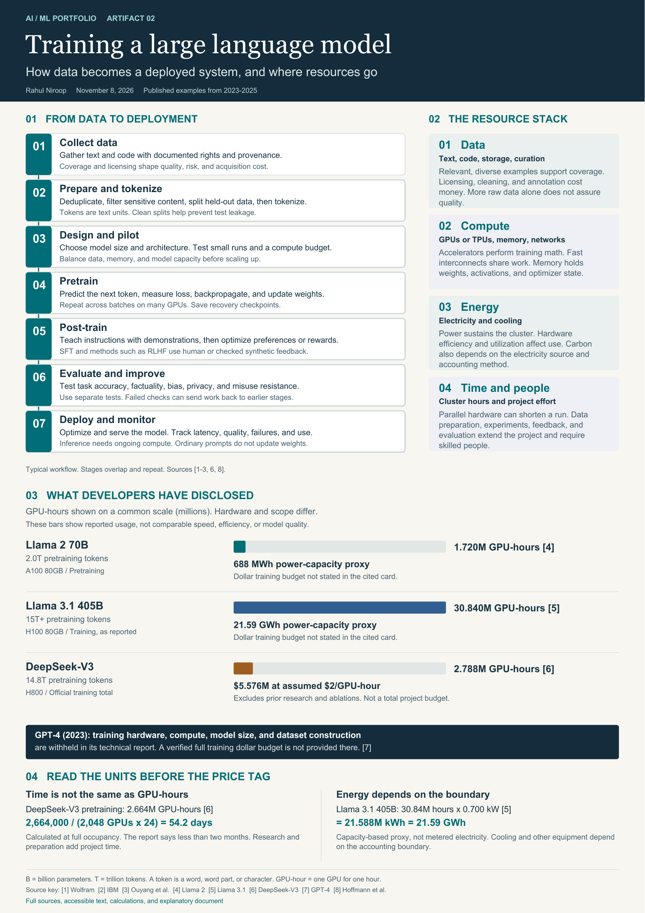

# LLM Training Resource Atlas

**Rahul Niroop · AI engineering and infrastructure · November 8, 2026**

[View the public portfolio artifact](https://luhar425.github.io/llm-training-resource-atlas/)

This second portfolio artifact explains seven LLM training stages, the infrastructure they require, and the meaning of published resource figures. It demonstrates technical research, resource estimation, evidence evaluation, and accessible visual communication.

## Submission files

- [Infographic PDF](assets/llm-training-infographic.pdf)
- [Infographic PNG](assets/llm-training-infographic.png)
- [Scalable SVG](assets/llm-training-infographic.svg)
- [Brief explanatory document PDF](documents/explanatory-document.pdf)
- [Editable explanatory document](documents/explanatory-document.docx)
- [Explanation and references in Markdown](documents/explanatory-document.md)

The website includes an accessible text equivalent, a model comparison table, source links, and a simple scenario calculator. It works as a static site without a build step or external assets.

## Evidence boundaries

The examples cover Llama 2 70B, Llama 3.1 405B, DeepSeek-V3, and GPT-4. GPU-hours differ by hardware and scope. Energy values are capacity-based calculations, not metered use. DeepSeek's $5.576 million figure assumes $2 per H800 GPU-hour and excludes earlier research and ablations. GPT-4's undisclosed quantities are not guessed. Historical reports are identified by model version.

## Portfolio connection

[Artifact 01: Machine Learning, Mapped](https://machine-learning-mapped-rahul-niroop.lovable.app/) demonstrates ML classification and model-selection reasoning. This artifact adds infrastructure and quantitative reasoning. Both are conceptual work rather than claims of personally training the models.

## View locally

Open `index.html` in a browser, or serve this directory with a static web server. No installation is required. Full sources are listed on the website and in the explanatory document.
